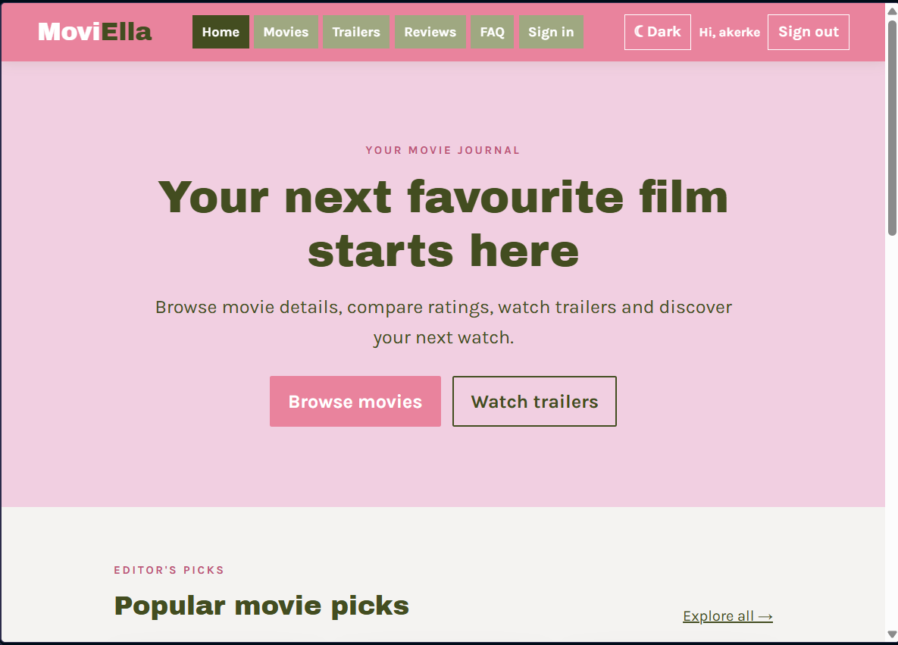
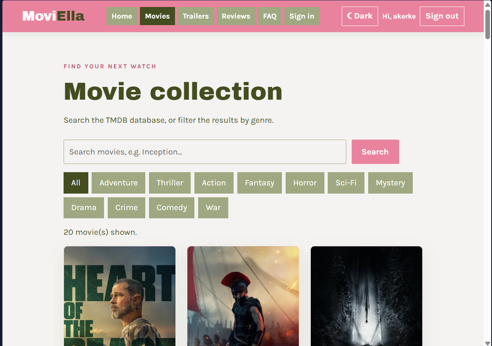
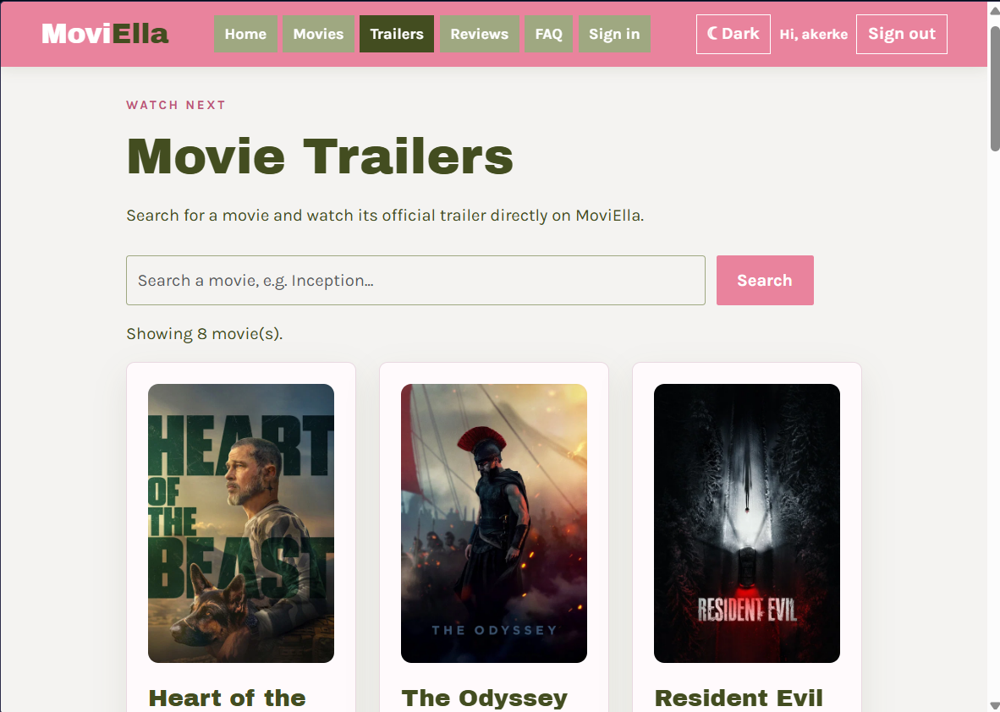
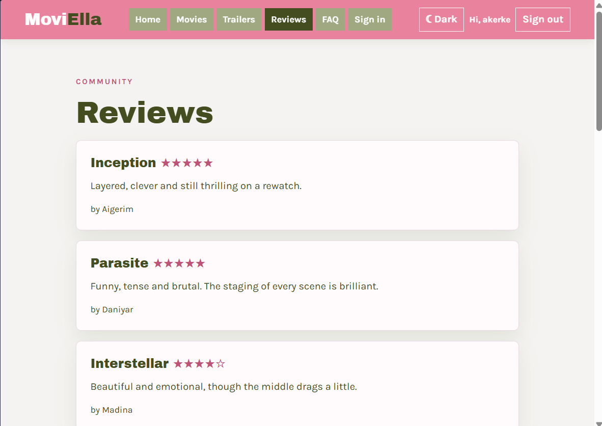
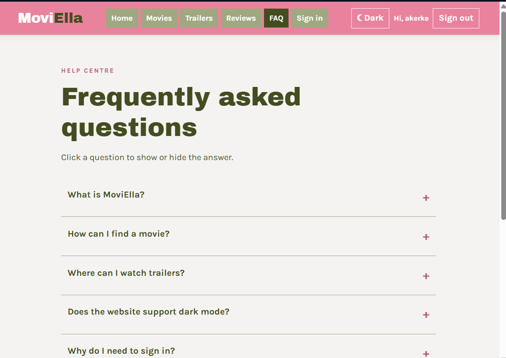
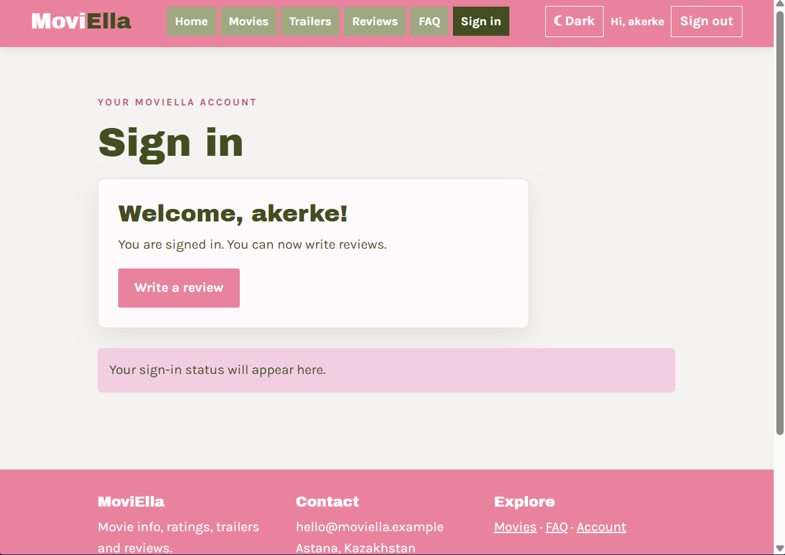
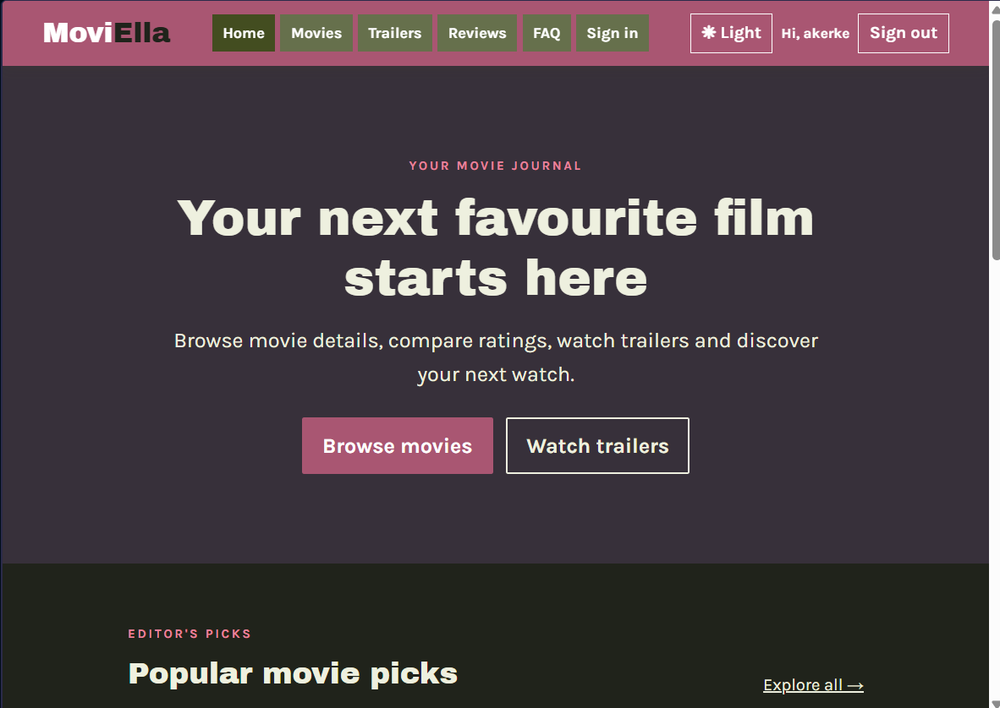
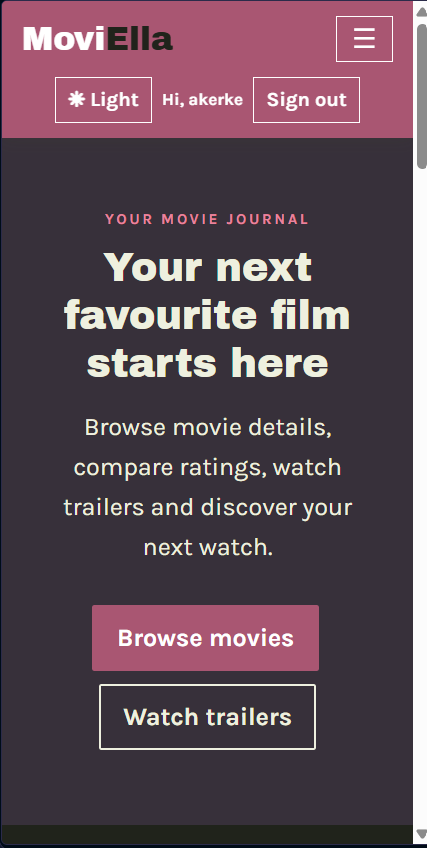

# MoviElla

MoviElla is a responsive movie website for browsing films, watching trailers and writing short reviews. It was built as the final project for Web Technologies-1 and uses live data from the TMDB (The Movie Database) API.
Github link:https://github.com/akerkeberdakul/final_project
Pages:https://akerkeberdakul.github.io/final_project/


## Project objectives

1. Build a multi-page website on a single topic (movies) with one navigation bar and one visual style on every page.
2. Use semantic HTML5, an external CSS file, Flexbox/Grid and a responsive layout for desktop, tablet and mobile.
3. Practise JavaScript with a light/dark theme and a sign-in system that use `localStorage`.
4. Practise jQuery with an FAQ section that opens and closes with `.slideToggle()`.
5. Integrate a real public API (TMDB) with `fetch()`, display its JSON data dynamically, let the user interact with it and handle errors.

## Team

| Member | Responsibility |
| --- | --- |
| Akerke | Home page; movie browsing, title search and genre filter on `movies.html`; TMDB requests with `async/await`; genre buttons built from the search results |
| Madina | Trailers page; trailer search and parallel loading with `Promise.all`; trailer selection (official trailer, trailer, teaser); client-side form validation |
| Aida | Reviews page and sign-in; `localStorage` for the user, reviews and theme; FAQ accordion with jQuery `.slideToggle()`; light/dark theme; project documentation (this README) |

## Website structure

| Page | What it does |
| --- | --- |
| `index.html` | Landing page with a hero section and three featured films |
| `movies.html` | Shows popular movies from TMDB, searches by title, filters results by genre |
| `trailers.html` | Searches movies and plays their YouTube trailers in embedded players |
| `reviews.html` | Lists reviews; signed-in users can post a rating and a comment |
| `faq.html` | Six questions that open and close with a sliding animation |
| `signin.html` | Validated sign-in form and a welcome view for the signed-in user |

All six pages share the same header (logo, navigation bar, theme button, user status, sign-out button) and the same footer, so every page can be reached from every other page.

```
MoviElla/
├── index.html
├── movies.html
├── trailers.html
├── reviews.html
├── faq.html
├── signin.html
├── css/
│   └── style.css
├── js/
│   └── script.js
├── screenshots/
└── README.md
```

## Implemented features
 
- **Movies:** popular films load on opening, search by title, and genre buttons filter the results.
- **Trailers:** search a movie and watch its YouTube trailer on the page. Trailers load in parallel with `Promise.all`.
- **Sign-in:** the form checks the name, email and password and shows an error under each field. The name and email are saved in `localStorage` and stay after a refresh. The password is never stored. Sign out clears the saved user.
- **Reviews:** signed-in users can post a rating (1–5) and a comment. Reviews are saved in `localStorage`.
- **Theme:** a button switches between light and dark mode on every page, and the choice is saved.
- **FAQ:** six questions that slide open and closed with jQuery `.slideToggle()`, with a `+` / `−` sign.
- **API errors:** a failed request or an empty search shows a clear message instead of a blank page.
- **Responsive design:** CSS Grid and Flexbox layouts that adapt to desktop, tablet and mobile.

## Development process

1. **Planning.** We chose the movie topic, listed the pages and agreed on one colour palette (olive, pink and blush) and two fonts.
2. **Layout.** We built the shared header and footer first, then the home page and the stylesheet.
3. **Features.** Each member built their own pages and scripts : API pages, trailers, then sign-in, reviews, theme and FAQ.
4. **Integration.** We connected all pages through the navigation bar and tested links, the theme and sign-in state on every page.
5. **Deployment.** The project was uploaded to GitHub and published with GitHub Pages. The API features were tested on the deployed site.

## Screenshots

| Page | Screenshot |
| --- | --- |
| Home (light) | |
| Movies with genre filter |  |
| Trailers | |
| Reviews |  |
| FAQ (one answer open) |  |
| Sign-in |  |
| Dark theme |  |
| Mobile view |  |

## Technologies

HTML5, CSS3 (Flexbox and Grid), JavaScript (ES6+), jQuery 3.7.1, Bootstrap 5.3, Google Fonts, TMDB API, GitHub Pages.

## Running locally

1. Download or clone the repository.
2. Open the folder in VS Code and start the page with the Live Server extension.
3. An internet connection is required for the CDN libraries, fonts and TMDB requests.

## Credits

Movie data and posters are provided by [TMDB](https://www.themoviedb.org/). This product uses the TMDB API but is not endorsed or certified by TMDB.
